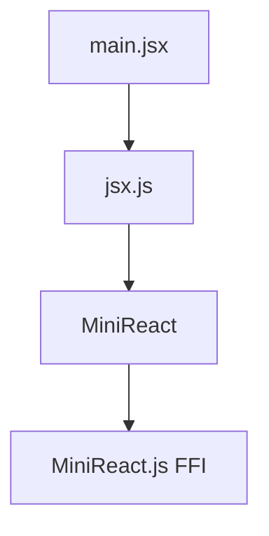
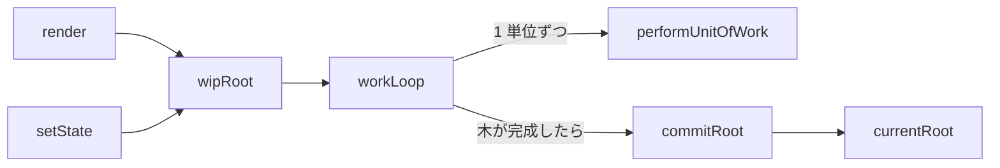

# Design

## module の構成

- `MiniReact`（`src/MiniReact.purs`）が本体で、React の仕組み全体を持つ。
- `src/MiniReact.js` は FFI で、DOM のプロパティへの代入、`===`、フレームのスケジューラ（`scheduleWork`）を持つ。
- `jsx.js` は、JS の値を `VirtualElement` に変換するアダプタで、`main.jsx` から使う `createElement` / `Fragment` / `useState` / `render` を提供する。PureScript の構築子の `.create` を使うので、コード生成の内部表現に依存する。

## 型

- `VirtualElement` は、`HostComponent tag props children`、`HostText text`、`Fragment children`、`FunctionComponent component` の直和である。
- `Prop` は、`Property key value`（`dom[key] = value`）と `Listener event listener` の直和である。
- `Component` は、描画関数と props の組を、props の型を隠して持つ（rank-N の存在型）。そのため、props の型が異なるコンポーネントも、1 つの木に入る。

## 描画の流れ

| 段階                  | 何をするか                                                                                                                                                                |
| --------------------- | ------------------------------------------------------------------------------------------------------------------------------------------------------------------------- |
| `render` / `setState` | ルートの fiber を作り、`wipRoot` と `nextUnitOfWork` に入れる                                                                                                             |
| `workLoop`            | フレームの残り時間がある間、`performUnitOfWork` を繰り返す。木ができたら `commitRoot` を呼ぶ                                                                              |
| `performUnitOfWork`   | fiber 1 つを処理する。関数コンポーネントなら描画関数を呼び、ホスト要素なら DOM を作る。子の fiber は `reconcileChildren` で作る。次の fiber（子 → 兄弟 → 親の兄弟）を返す |
| `commitRoot`          | 削除を反映した後、木をたどって DOM に挿入・更新する。`currentRoot` を入れ替える                                                                                           |

## Fiber

- `Fiber` は `Ref FiberRec` で、`parent` / `child` / `sibling` でつながる。この形だと、次に処理する fiber 1 つを覚えておくだけで、中断した探索を再開できる。
- `alternate` は、前回 commit した木で対応する fiber を指す。
- 描画の状態（`wipRoot`、`currentRoot`、`nextUnitOfWork`、`deletions`、`wipFiber`、`hookIndex`）は、module レベルの `Ref` に持つ。

## Reconcile

- 子は index で対応づける。key はない。
- 同じ種類なら Update（前回の DOM を引き継ぐ）、違えば Placement（新しく作る）にし、前回の fiber を `deletions` に入れる。
- 同じ種類かどうかは、ホスト要素ならタグ名で、関数コンポーネントなら描画関数の参照（`===`）で判定する。`jsx.js` は、同じ JS の関数に同じラッパーを返すよう `WeakMap` でキャッシュする。キャッシュがないと、描画のたびにすべてのコンポーネントが作り直され、state が消える。

## Commit

- 削除は、DOM を持たない fiber（関数コンポーネント、Fragment）なら、子孫の DOM を消す。
- 親の DOM の中で直前に確定した DOM を持ち回り、Placement はその直後に挿入する。そのため、新しい要素は正しい位置に入る。
- commit が終わった fiber の `alternate` を消す。そうしないと、過去の木が鎖のようにつながったまま、GC されない。

## Hooks

- hook は fiber の `hooks` に、呼ばれた順に並ぶ。前回の hook は、`alternate` の `hooks` から同じ index で取り出す。
- state の型は `HookState` に消して持つ（`unsafeCoerce`）。正しい型で取り出せることは、hook を毎回同じ順で呼ぶというルールだけが保証する。
- `setState` は値を丸ごと置き換える（マージしない）。描画中の `setState` はキューに積むだけで、まとめて反映する。

## スケジューラ

- `scheduleWork` は、`requestAnimationFrame` でフレームの開始時刻を受け取り、締め切りを「開始時刻 + 1/60 秒」として、`MessageChannel` でコールバックを呼ぶ。`window.requestIdleCallback` は書き換えない。
- ループは `render` のときに始まり、仕事がなくても毎フレーム回り続ける。
- 画面に描画されていないページでは、フレームが進まないので何も描画されない。

## 制約

- `render` は 1 回だけ呼ぶ前提である。2 回目は前回の木と比べないので、DOM が二重になり、ループも 2 本になる。
- class component、key、`useState` 以外の hook はない。
